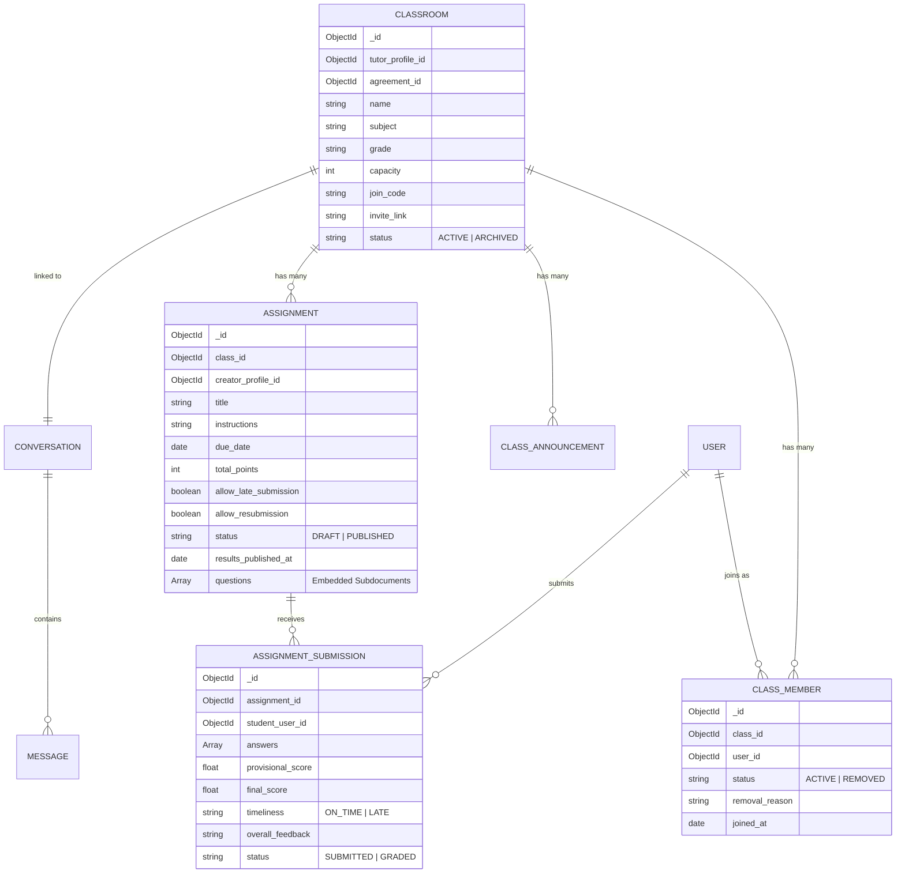

# TÀI LIỆU ÔN TẬP VÀ REVIEW VỚI GIẢNG VIÊN (NHÁNH CƯỜNG)
**Phân hệ: Classroom & Learning Management (UC21, UC22, UC23, UC24, UC26, UC27, UC33)**

---

## I. TỔNG QUAN KIẾN TRÚC HỆ THỐNG (SYSTEM ARCHITECTURE)

Hệ thống được xây dựng theo mô hình **Client - Server Monorepo** hiện đại:

```mermaid
graph TD
    subgraph Client ["Frontend (React 19 + Vite)"]
        UI["UI Pages & Modals"]
        State["React State & useAuth"]
        APIClient["ClassroomService (Axios)"]
        UI --> State --> APIClient
    end

    subgraph Server ["Backend (Express 5 + Node.js)"]
        Router["classroom.routes.js"]
        AuthMiddleware["classroomAuth.middleware.js (RBAC)"]
        Controller["classroom.controller.js"]
        Service["classroom.service.js (Business Logic)"]
        Router --> AuthMiddleware --> Controller --> Service
    end

    subgraph Database ["MongoDB Database (WDP_DB)"]
        M1[(Classroom)]
        M2[(ClassMember)]
        M3[(ClassAnnouncement)]
        M4[(Assignment)]
        M5[(AssignmentSubmission)]
        M6[(Conversation & Message)]
        Service --> Database
    end

    APIClient -->|HTTP REST API + JWT| Router
```

### 1. Kiến trúc phân tầng Backend (Layered Architecture):
* **Router Layer (`classroom.routes.js`):** Định tuyến URL, phân định middleware xác thực (`requireUserAuth` vs `requireTutorAuth`).
* **Middleware Layer (`classroomAuth.middleware.js`):** Giải mã JWT token, kiểm tra vai trò (TUTOR / STUDENT / PARENT) và nạp `req.tutorProfile`.
* **Controller Layer (`classroom.controller.js`):** Tiếp nhận `req`, trích xuất `params`/`body`/`query`, xử lý bắt lỗi bằng `asyncHandler` và chuẩn hóa phản hồi bằng `responseCommon`.
* **Service Layer (`classroom.service.js`):** Trái tim của phân hệ — chứa **100% logic nghiệp vụ**, xử lý tính toán điểm, kiểm tra sức chứa, điều kiện hạn nộp, và tương tác với cơ sở dữ liệu qua Mongoose Models.

---

## II. THIẾT KẾ CƠ SỞ DỮ LIỆU & QUAN HỆ (DATA MODELS)



---

## III. CHI TIẾT LUỒNG DỮ LIỆU CỦA 7 USE CASE

### 1. UC21: Create Classroom (Khởi tạo lớp học)
* **Actor:** Gia sư (Tutor).
* **Luồng chạy:**
  1. Gia sư điền thông tin lớp (hoặc chọn thỏa thuận đã chốt ở UC18/UC21.A1 để tự động điền môn học, học phí, lịch học).
  2. Frontend gửi `POST /api/classroom/v1` kèm payload: `{ name, subject, grade, capacity, description, agreement_id }`.
  3. Backend xác thực `requireTutorAuth`.
  4. Service kiểm tra tính hợp lệ (sĩ số từ 1 - 200, tên ≥ 3 ký tự).
  5. Tự động sinh `join_code` ngẫu nhiên (dạng `TCxxxxxx`) và `invite_link`.
  6. **Tự động liên kết UC33:** Khởi tạo một `Conversation` kiểu `CLASS_GROUP_CHAT` kết nối với `class_id`.
  7. Trả về thông tin lớp học và hiển thị popup sao chép mã mời / link mời ngay lập tức.

---

### 2. UC22: Manage Classroom (Quản lý thiết lập & Bảng tin lớp)
* **Actor:** Gia sư chủ lớp.
* **Các chức năng chính:**
  * **Chỉnh sửa thông tin:** `PUT /:id` — cập nhật tên, môn, sĩ số tối đa (không được nhỏ hơn sĩ số học sinh hiện tại).
  * **Đổi mã mời (`Regenerate Code`):** `POST /:id/regenerate-code` — hủy mã cũ, cấp mã mới nếu nghi ngờ mã cũ bị lộ.
  * **Chuyển đổi trạng thái:** `PATCH /:id/status` (`ACTIVE` ↔ `ARCHIVED`).
  * **Bảng tin lớp học (Announcements):**
    * Đăng thông báo: `POST /:id/announcements` (hỗ trợ ghim `is_pinned`).
    * Ghim / Bỏ ghim: `PATCH /:id/announcements/:announcementId/pin`.
    * Chỉnh sửa / Xóa thông báo: `PUT` / `DELETE`.

---

### 3. UC23: Manage Class Members (Quản lý thành viên lớp)
* **Actor:** Gia sư chủ lớp.
* **Các chức năng chính:**
  * **Xem danh sách thành viên:** `GET /:id/members` — hiển thị rõ học sinh, phụ huynh và **liên kết Phụ huynh - Con** (`ParentChildLink`).
  * **Thêm học viên bằng email:** `POST /:id/members` — Gia sư nhập email học sinh đã đăng ký tài khoản để đưa trực tiếp vào lớp.
  * **Gỡ học viên khỏi lớp (Remove Member):** `DELETE /:id/members/:memberId` — Gia sư bắt buộc nhập **lý do gỡ**.
  * **Quy tắc bảo mật sống còn:** Bản ghi thành viên được đổi thành `status = 'REMOVED'`. Học sinh bị gỡ **không thể tự ý nhập mã mời cũ để vào lại lớp** (chặn tái nhập học trái phép).

---

### 4. UC24: Join Classroom (Tham gia lớp học)
* **Actor:** Học sinh (Student), Phụ huynh (Parent).
* **Luồng chạy:**
  1. Người dùng nhập mã tham gia hoặc truy cập link mời dạng `/join-class/:code`.
  2. Hệ thống gọi `GET /api/classroom/v1/preview/:joinCode` (Public, không cần đăng nhập trước để xem thông tin lớp: Tên lớp, Gia sư phụ trách, Sĩ số hiện tại / tối đa).
  3. Người dùng bấm **"Tham gia lớp học"** ➔ Gọi `POST /api/classroom/v1/join`.
  4. Backend thực hiện **4 tầng kiểm tra**:
     * *Tầng 1:* Lớp học có đang ở trạng thái `ACTIVE` không?
     * *Tầng 2:* Người dùng có phải chính là Gia sư chủ lớp không? (Gia sư không được tự tham gia lớp của mình với vai trò học sinh).
     * *Tầng 3:* Lớp đã đầy sĩ số (`memberCount >= capacity`) chưa?
     * *Tầng 4:* Người dùng có đang ở trạng thái `REMOVED` không? Nếu có, ném lỗi 403 chặn tham gia.
  5. Nếu người dùng là **Phụ huynh (Parent)** có chọn con đang học trong lớp ➔ Tự động tạo bản ghi liên kết `ParentChildLink`.

---

### 5. UC26: Manage Assignments & Grading (Quản lý bài tập & Chấm điểm)
* **Actor:** Gia sư chủ lớp.
* **Luồng chạy:**
  * **Tạo / Sửa đề bài:** Hỗ trợ tạo tay hoặc **AI Assistant** sinh đề tự động theo môn học.
  * Hỗ trợ 3 loại câu hỏi:
    1. `MULTIPLE_CHOICE` (Trắc nghiệm 4 đáp án A/B/C/D, có đáp án đúng để máy tự chấm).
    2. `SHORT_ANSWER` (Câu trả lời ngắn).
    3. `FILE_UPLOAD` (Yêu cầu nộp file / dán link sản phẩm).
  * Đặt hạn nộp (`due_date`), cho phép nộp trễ (`allow_late_submission`), cho phép nộp lại (`allow_resubmission`).
  * **Quy tắc bảo vệ dữ liệu:** Khi bài tập đã được công bố kết quả (`results_published_at`), hệ thống **khóa toàn bộ nội dung đề và điểm từng câu** để không làm sai lệch kết quả đã công bố.
  * **Chấm điểm bài nộp:** Gia sư mở danh sách bài làm (`GET /submissions`), nhập `final_score` và `overall_feedback` ➔ Bấm **Công bố kết quả**.

---

### 6. UC27: Do Assignment (Làm và nộp bài tập)
* **Actor:** Học sinh trong lớp.
* **Luồng chạy:**
  1. Học sinh mở bài tập, trả lời trắc nghiệm, gõ câu trả lời tự luận và dán link nộp bài.
  2. Bấm nộp bài ➔ Gọi `POST /assignments/:id/submit`.
  3. Backend kiểm tra:
     * Phải là thành viên `ACTIVE` của lớp.
     * Kiểm tra thời hạn: Nếu quá hạn nộp mà lớp cho phép nộp trễ ➔ Đánh dấu `timeliness = 'LATE'`. Nếu không cho nộp trễ ➔ Báo lỗi chặn nộp.
     * Chặn nộp lại nếu bài đã công bố điểm (`results_published_at`).
  4. **Chấm điểm tự động (Auto-grading):**
     * Backend duyệt qua các câu hỏi `MULTIPLE_CHOICE`, so sánh đáp án của học sinh với `correct_answer`.
     * Tự động tính tổng điểm và lưu vào trường `provisional_score` (Điểm tạm tính).
  5. Học sinh xem được điểm trắc nghiệm ngay trên màn hình hoàn tất nộp bài.

---

### 7. UC33: Create & Manage Group Chat (Nhóm chat lớp học)
* **Actor:** Gia sư chủ lớp và Thành viên lớp.
* **Luồng chạy:**
  1. Phòng chat tự động được khởi tạo (`Conversation`) ngay khi lớp được tạo ở UC21.
  2. Gọi `GET /:id/chat`: Lấy 100 tin nhắn gần nhất cùng danh sách toàn bộ thành viên nhóm kèm huy hiệu vai trò (`👨‍🏫 Gia sư`, `🎒 Học sinh`, `👨‍👩‍👧 Phụ huynh`).
  3. Gửi tin nhắn: `POST /:id/chat` kiểm tra quyền (chỉ thành viên đang học hoặc gia sư mới được gửi).
  4. Giao diện tích hợp cơ chế tự động làm mới tin nhắn định kỳ (Polling 4 giây) và tự cuộn mượt xuống đáy hộp thoại.

---

## IV. BỘ CÂU HỎI THƯỜNG GẶP VÀ CÁCH TRẢ LỜI VỚI THẦY CÔ (Q&A DEFENSE)

### Câu 1: "Tại sao em tách Controller và Service riêng biệt mà không viết chung vào một chỗ?"
> **Trả lời:** Em áp dụng nguyên lý **Separation of Concerns (Tách biệt mối quan tâm)** trong kiến trúc phân tầng:
> - **Controller** chỉ làm nhiệm vụ tiếp nhận HTTP Request, đọc `body/params`, gọi Service và trả về JSON chuẩn hóa (bắt lỗi HTTP status code).
> - **Service** là nơi chứa toàn bộ Business Logic nghiệp vụ thuần túy và thao tác cơ sở dữ liệu. Nhờ vậy mã nguồn rất sạch, dễ dàng viết Unit Test độc lập và có thể tái sử dụng logic ở nhiều nơi mà không phụ thuộc vào đối tượng `req, res`.

---

### Câu 2: "Khi thành viên bị Gia sư gỡ khỏi lớp (UC23), em xử lý trạng thái dữ liệu như thế nào? Tại sao không dùng `deleteOne` để xóa hẳn?"
> **Trả lời:** Em sử dụng kỹ thuật **Soft Delete (Xóa mềm)** bằng cách cập nhật `status = 'REMOVED'` kèm theo trường `removal_reason`:
> 1. Giữ lại lịch sử và tính toàn vẹn dữ liệu: Các bài tập cũ học sinh đã nộp trước đó không bị mồ côi (orphan data).
> 2. Đảm bảo quy tắc bảo mật nghiệp vụ (UC23/UC24): Khi một học sinh bị gỡ, nếu dùng `deleteOne` thì học sinh đó có thể lấy mã mời cũ để tự ý tham gia lại lớp. Nhờ lưu trạng thái `REMOVED`, hệ thống sẽ chặn mã mời và chỉ cho phép vào lại khi chính Gia sư chủ động thêm lại bằng email.

---

### Câu 3: "Cơ chế tự động chấm điểm bài trắc nghiệm ở UC27 hoạt động ra sao?"
> **Trả lời:** Trong schema của `Assignment`, mỗi câu hỏi trắc nghiệm đều lưu `correct_answer` và `points`. Khi học sinh nộp bài:
> - Backend duyệt qua mảng câu trả lời của học sinh, tìm câu hỏi tương ứng trong database.
> - So sánh đáp án chọn với `correct_answer`. Nếu đúng thì cộng dồn số điểm của câu hỏi đó vào `provisional_score` (Điểm tạm tính).
> - Điểm này được phản hồi về ngay lập tức cho học sinh biết kết quả trắc nghiệm, trong khi các câu tự luận và file upload sẽ chờ gia sư chấm điểm chính thức (`final_score`) ở UC26.

---

### Câu 4: "Làm sao hệ thống phân biệt được giao diện cho Gia sư và Học sinh khi cùng truy cập vào một trang lớp học?"
> **Trả lời:** Hệ thống sử dụng **Role-Based UI Rendering**:
> - Trên thanh Header: Đọc `user.role` từ `useAuth` hook để hiển thị nhãn nhận diện (`👨‍🏫 Gia sư`, `🎒 Học sinh`, `👨‍👩‍👧 Phụ huynh`).
> - Trong chi tiết lớp học: API `getClassroomDetail` trả về cờ `is_owner`. Frontend kiểm tra `Boolean(classroom.is_owner)`:
>   - Nếu là Gia sư chủ lớp: Hiển thị các nút cấu hình lớp, đổi mã mời, đăng bảng tin, tạo bài tập, chấm điểm và gỡ thành viên.
>   - Nếu là Học sinh: Ẩn toàn bộ nút quản trị, chỉ hiển thị nút làm bài tập (`✍️ Làm bài tập`), xem điểm và tham gia chat nhóm.

---

### Câu 5: "Khi bài tập đã được công bố điểm, nếu gia sư sửa lại câu hỏi hoặc điểm số thì sao?"
> **Trả lời:** Để tránh xung đột dữ liệu và đảm bảo tính công bằng học thuật (UC26 & UC27):
> - Khi gia sư đã công bố kết quả (`results_published_at != null`), hệ thống sẽ **khóa chỉnh sửa cấu trúc đề bài** (không cho phép sửa nội dung câu hỏi, xóa câu hoặc đổi thang điểm).
> - Đồng thời học sinh cũng bị khóa không được phép nộp lại (`resubmit`) sau khi điểm đã công bố công khai.
