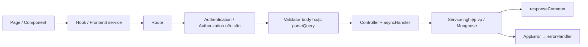

# Luồng triển khai UC01, UC02, UC03, UC04, UC17, UC18, UC37, UC39

Ngày đối chiếu: 08/11/2026. Baseline: `d124f7a` (`clean be`), cập nhật thêm triển khai UC03/UC04 trong working tree.
Tài liệu mô tả **code hiện có**, phân biệt rõ với luồng mới chỉ có trong SRS.
Không chứa giá trị secret, không thay thế kiểm thử tích hợp với DB/email/PSP thật.

## 1. Phạm vi và cách đọc

| UC | Tên dùng trong tài liệu này | Tình trạng thực tế |
| --- | --- | --- |
| UC01 | Register Account | Đã có email verification link và Google registration |
| UC02 | Login | Đã có email/password, Google, cookie JWT và logout |
| UC03 | Forgot Password | Đã có reset link một lần, cooldown và trang reset password |
| UC04 | Change Password | Đã có Change/Set password trong dashboard, thu hồi phiên cũ |
| UC17 | Upgrade Plan & Buy Credits | Có checkout, PSP, polling, webhook và cấp quyền lợi; còn giới hạn ở mục 6 |
| UC18 | View Credits & Transactions | Có số dư, lịch sử, phân trang, lọc và CSV |
| UC37 | Manage User Accounts | Có danh sách/chi tiết user, đổi trạng thái và tạo admin |
| UC39 | Manage Plans & Pricing | Có tạo/sửa plan, đổi khả dụng và quản lý credit pack |

**Đánh số:** UC17/18/37/39 theo [SRS billing/admin đã triển khai](requirements/uc17_18_37_39.md).
SRS mới ở `TuConnector_SRS.md` đã đổi một số số hiệu; không dùng số hiệu mới để
suy ra rằng UC17 ở đây là Respond to Invitation. UC01–04 đối chiếu thêm
`docs/requirements/TuConnector_SRS_v1.0_dongbo_v10.docx.md`.

**Ký hiệu:** `controller.x()` và `service.x()` là hai function ở hai tầng khác nhau,
dù cùng tên. Bảng file bên dưới xác định đúng module. `Model.method()` là thao tác
Mongoose, không phải một repository tự viết.

### Luồng backend dùng chung



Các route được mount ở `backend/src/routes/index.routes.js`, bên dưới prefix `/api`.
File dùng chung:

- `backend/src/common/middlewares/auth.middleware.js`: `getToken()`, `authentication()`, `authorize()`.
- `backend/src/common/validator/validator.js`: `validator(schema)` kiểm tra body.
- `backend/src/common/utils/pagination.js`: `parseQuery()`, `getPagination()`, `buildPagination()`.
- `backend/src/common/utils/asyncHandler.js`: chuyển lỗi async sang middleware lỗi.
- `backend/src/common/utils/AppError.js`, `backend/src/common/middlewares/error.middleware.js`: lỗi nghiệp vụ/HTTP.
- `backend/src/common/response.js`: `responseCommon(res, data, message, statusCode, success)`.
- `frontend/src/services/api.js`: Axios instance dùng chung.
- `frontend/src/routes/routes.jsx`: route màn hình và `WorkspaceRedirect()`.

## 2. UC01 — Register Account

### File liên quan

| Tầng | File và nhiệm vụ |
| --- | --- |
| Page | `frontend/src/pages/auth/Register.jsx`: nhập thông tin, chọn role, đồng ý điều khoản |
| Page | `frontend/src/pages/auth/RegisterSuccess.jsx`: thông báo kiểm tra email, gửi lại link |
| Page | `frontend/src/pages/auth/RegisterComplete.jsx`: hoàn tất đăng ký Google, chọn role |
| UI | `frontend/src/components/register/RegisterInfoStep.jsx`, `PasswordStrengthMeter.jsx`: thông tin/mật khẩu |
| UI | `frontend/src/components/common/RegisterConfirmStep.jsx`, `ResendVerificationButton.jsx` |
| State/API | `frontend/src/hooks/useAuth.jsx`, `frontend/src/services/authService.js` |
| Validation | `frontend/src/utils/authValidators.js`, `backend/src/common/validator/authSchema.js` |
| Backend | `backend/src/routes/auth.routes.js`, `backend/src/controllers/auth.controller.js`, `backend/src/services/auth.service.js`, `backend/src/services/user.service.js` |
| Mail/config | `backend/src/common/utils/mailer.js`, `backend/src/common/utils/html.js`, `backend/src/config/environment.js` |
| Data | `backend/src/models/User.js`, `backend/src/models/EmailVerificationToken.js` |

### Đăng ký bằng email

1. `/register`: `Register.handleSubmit()` gọi `AuthProvider.register()` rồi
   `authService.register()` ở frontend → `POST /api/auth/v1/register`.
2. Route public → `validator(registerSchema)` → `auth.controller.register()`.
3. `auth.service.register()` → `User.findOne({ email })` kiểm tra trùng →
   `bcrypt.hash(password, 10)` → `user.service.createUser(newUser, 'Regular')` → `User.create()`.
4. Role lưu đúng lựa chọn `TUTOR`/`PARENT`/`STUDENT`; `email_verify_status` ban đầu false.
   Không đổi user thành role GUEST. Việc chặn đăng nhập thực hiện ở UC02.
5. `createAndSendVerification()` → xóa token cũ → `crypto.randomBytes(32)` →
   `hashToken()` bằng SHA-256 → `EmailVerificationToken.create()` → `sendVerificationEmail()`.
6. Backend trả 201 với user đã qua `removePasswordHash()`; frontend mở `/register/success`.
   Không cấp JWT đăng nhập ở bước đăng ký email này.

Mật khẩu: 8–64 ký tự, ít nhất một chữ hoa, một chữ thường, một chữ số; xác nhận phải khớp.
Email trùng trả 409. Gửi email lỗi được log, tài khoản vẫn giữ để có thể gửi lại.

### Kích hoạt và gửi lại email

```text
GET /api/auth/v1/verify-email?token=...
  → controller.verifyEmail()
  → service.verifyEmail(rawToken)
  → hashToken() → EmailVerificationToken.findOne(token còn hạn)
  → User.findByIdAndUpdate(email_verify_status = true)
  → EmailVerificationToken.deleteMany()
  → redirect /login?verify=success hoặc /login?verify=invalid
```

Token có hạn 24 giờ. Link sai/hết hạn không kích hoạt tài khoản.
`POST /resend-verification` → `validator(resendVerificationSchema)` →
`controller.resendVerification()` → `service.resendVerification()` →
`createAndSendVerification()`. Cooldown 60 giây; phản hồi trung tính khi email không
tồn tại, đã xác thực hoặc còn cooldown, nhằm hạn chế dò tài khoản.

### Đăng ký bằng Google

```text
getGoogleLoginUrl() → GET /api/auth/v1/google
  → controller.googleRedirect(): tạo cookie oauth_state
  → service.getGoogleAuthUrl() → Google consent
  → GET /api/auth/v1/oauth/redirect
  → controller.googleCallback(): kiểm tra state
  → service.handleGoogleCallback(): getToken() + verifyIdToken()
```

- Google account đã tồn tại: đi tiếp luồng đăng nhập UC02.
- Email trùng tài khoản thường: liên kết Google và bật email verification.
- User mới: trả registration ticket JWT 15 phút, redirect `/register/complete?ticket=...`.
- `RegisterComplete.handleSubmit()` → `completeGoogleRegister()` ở AuthProvider/API
  → `POST /api/auth/v1/google/complete` → `validator(googleCompleteSchema)` →
  `controller.googleComplete()` → `service.completeGoogleRegister()`.
- Service kiểm tra ticket và trùng email/Google ID → `createUser(..., 'OAuth2')` →
  `issueToken()`; controller `setAuthCookie()`. Tài khoản dùng role vừa chọn, đã xác thực email,
  chưa có password. Frontend chuyển tới `/dashboard`.

**Thêm/sửa/xóa:** Các màn đăng ký/Google completion, validation, token và mail là phần
triển khai UC01 hiện có. Cleanup gần nhất chỉ thay helper escape HTML của mailer
bằng `common/utils/html.js`; không xóa route/function đăng ký. Không thêm schema trong lượt viết tài liệu.

## 3. UC02 — Login

### File liên quan

- `frontend/src/pages/auth/Login.jsx`, `frontend/src/hooks/useAuth.jsx`.
- `frontend/src/services/authService.js`, `frontend/src/routes/GuestRoute.jsx`,
  `PrivateRoute.jsx`, `RoleRoute.jsx`, `redirectAfterLogin.js`, `routes.jsx`.
- `frontend/src/utils/publicProfileReturn.js`: nhớ public profile khi đăng nhập từ UC07.
- Backend dùng lại auth route/controller/service/validator và `user.service.js` của UC01.
- `backend/src/common/middlewares/auth.middleware.js`, `backend/src/models/User.js`.

### Email/password

```text
Login.handleSubmit()
  → AuthProvider.login() → frontend authService.login()
  → POST /api/auth/v1/login
  → validator(loginSchema) → controller.login()
  → service.login()
     → User.findOne().select('+password_hash')
     → bcrypt.compare()
     → kiểm tra account_status ACTIVE và email_verify_status true
     → userService.updateUserLogin()
     → removePasswordHash() + issueToken()
  → controller.setAuthCookie() → responseCommon()
  → AuthProvider lưu user → getPathAfterLogin() / GuestRoute
```

Sai email/password hoặc Google-only chưa có password: 401. Tài khoản bị khóa hoặc
chưa verify: 403, kiểm tra sau khi password đúng. Cookie `token` là httpOnly,
sameSite `lax`, secure ở production, maxAge 12 giờ; JWT dùng cấu hình expiry riêng.

### Khôi phục phiên, phân quyền và logout

- Khi mở app, `AuthProvider` gọi frontend `me()` → `GET /api/auth/v1/me` →
  `authentication()` → `controller.me()` → `service.me()` → `User.findById()`.
- `authentication()` đọc cookie/Bearer, `jwt.verify()`, rồi đọc lại role và trạng thái
  User trong DB ở mỗi request. Admin khóa tài khoản có hiệu lực với request tiếp theo.
- `authorize(...roles)` chặn role không có quyền; route admin dùng ADMIN.
- `/dashboard` đi qua `WorkspaceRedirect()` để tới dashboard theo role hoặc public
  profile đang được nhớ. `getPathAfterLogin()` ưu tiên trang đã lưu trong router state.
- `AuthProvider.logout()` → frontend `logout()` → `POST /api/auth/v1/logout` →
  `controller.logout()` → `res.clearCookie('token')`; frontend xóa user.
  Logout không đòi token còn hạn. Đây là xóa cookie trình duyệt, chưa phải blacklist mọi JWT đã cấp.

Google login dùng `googleRedirect()` → `getGoogleAuthUrl()` → `googleCallback()` →
`handleGoogleCallback()` → `updateUserLogin()` → `issueToken()` → `setAuthCookie()`.
State sai hoặc lỗi OAuth redirect về Login; tài khoản khóa dùng `?oauth=locked`.

**Thêm/sửa/xóa:** Đã có Google login, chặn chưa verify, khôi phục phiên và bảo vệ route.
Luồng trở về public profile được nối thêm trong UC07. Cleanup không xóa auth function.
JWT hiện còn kiểm tra password version theo UC04. Các field đếm đăng nhập sai trong model chưa đồng nghĩa với việc đã có cơ chế khóa
sau N lần sai: `login()` hiện chưa thực hiện phần đếm này.

## 4. UC03 — Forgot / Reset Password

### File liên quan và thay đổi

| Thêm/sửa | File | Nhiệm vụ |
| --- | --- | --- |
| Thêm | `frontend/src/pages/auth/ForgotPassword.jsx` | Email, thông báo trung tính và cooldown gửi lại |
| Thêm | `frontend/src/pages/auth/ResetPassword.jsx` | Nhận token từ URL, nhập password mới, lỗi link hết hạn |
| Thêm | `frontend/src/components/auth/NewPasswordFields.jsx`, `frontend/src/utils/passwordValidators.js` | Dùng chung BR-01/confirmation với UC04 |
| Thêm | `frontend/src/styles/passwordRecovery.css` | Giao diện recovery theo bố cục auth hiện có |
| Thêm | `backend/src/services/password.service.js` | Phát/reset token, cập nhật password và chống cập nhật đồng thời |
| Thêm | `backend/src/common/utils/authSession.js` | Cấp JWT gắn với phiên bản password |
| Sửa | `backend/src/common/validator/authSchema.js` | `forgotPasswordSchema`, `resetPasswordSchema`, `changePasswordSchema` |
| Sửa | `backend/src/routes/auth.routes.js`, `backend/src/controllers/auth.controller.js` | Ba API password và cookie |
| Sửa | `backend/src/common/utils/mailer.js` | `sendPasswordResetEmail()`, `sendPasswordChangedEmail()` |
| Sửa | `frontend/src/services/authService.js`, `frontend/src/hooks/useAuth.jsx` | Gọi API và xóa session FE sau reset |
| Sửa | `frontend/src/pages/auth/Login.jsx`, `frontend/src/pages/auth/Register.jsx`, `frontend/src/routes/routes.jsx` | Bỏ link placeholder, nối `/forgot-password` và `/reset-password` |
| Dùng lại | `backend/src/models/PasswordResetToken.js`, `backend/src/models/User.js` | Giữ nguyên schema; PasswordResetToken đã có từ `559ea5f` |
| Thêm | `backend/tests/unit/password.test.js`, `frontend/tests/passwordPages.test.js`, `frontend/tests/sessionExpiry.test.js` | Kiểm thử token, session, validation và trạng thái form |

### Gửi reset link

```text
ForgotPassword.handleSubmit()
  → frontend authService.forgotPassword({email})
  → POST /api/auth/v1/forgot-password
  → validator(forgotPasswordSchema) → controller.forgotPassword()
  → passwordService.forgotPassword(email)
     → schedule deliverResetLink() bằng setImmediate
  → phản hồi 200 trung tính ngay, không chờ SMTP

Background deliverResetLink()
  → User.findOne(email, ACTIVE, email đã verify)
  → randomBytes(32) → SHA-256 token + phiên bản credential
  → PasswordResetToken.findOneAndUpdate(upsert, kiểm tra cooldown)
  → sendPasswordResetEmail(link từ CORS_ORIGIN + /reset-password?token=...)
```

Token sống 15 phút. `token_value` lưu `SHA256(rawToken):passwordVersion(password_hash)`,
không lưu raw token hoặc password hash gốc. Mỗi user dùng một record reset có `_id`
bằng User ID để tận dụng unique `_id` có sẵn, không thêm index/schema. Điều kiện
upsert giữ cooldown 60 giây; duplicate-key do cooldown/concurrent request trả trung tính.
Gửi lại thành công thay token cũ. Email không tồn tại/inactive/chưa verify vẫn nhận
cùng thông báo; lỗi nền/SMTP không trả thông tin tài khoản ra HTTP.
Nếu SMTP lỗi, chỉ xóa record có đúng hash vừa phát, không xóa nhầm token mới hơn.

### Đặt lại mật khẩu

```text
ResetPassword.handleSubmit()
  → AuthProvider.resetPassword() → frontend authService.resetPassword()
  → POST /api/auth/v1/reset-password {token,new_password,confirm_password}
  → validator(resetPasswordSchema) → controller.resetPassword()
  → passwordService.resetPassword()
     → hash token → PasswordResetToken.findOne(chưa dùng, còn hạn)
     → User.findById() → kiểm tra trạng thái, credential version và password mới khác cũ
     → bcrypt.hash() password mới
     → findOneAndUpdate(is_used=false, còn hạn) để consume token một lần
     → updatePassword()
        → User.findOneAndUpdate(credential cũ + ACTIVE)
        → xóa reset token của user → gửi mail báo đổi password
  → clear cookie token, không tự đăng nhập
  → AuthProvider xóa user → /login?password=reset
```

BR-01: 8–64 ký tự, có hoa/thường/số, confirmation khớp. Link sai/hết hạn/đã dùng
trả 410; password mới trùng cũ trả lỗi và không coi link là hết hạn. Reset thành công
đặt `has_password=true`, xóa trạng thái khóa do đăng nhập sai; không mở khóa SUSPENDED/BANNED.
JWT cũ bị từ chối vì password version thay đổi, xem UC04.

**Giới hạn:** delivery nền chạy trong process, chưa có durable queue; restart có thể
làm mất mail đang chờ, user dùng resend. Nếu consume token xong mà cập nhật DB thất bại,
không khôi phục token đã dùng; phải xin link mới. Không mô tả đây là DB transaction.
Reset link còn sót do lỗi cleanup cũng bị từ chối sau khi credential thay đổi, nhờ
phiên bản được gắn trong token_value. Nếu cập nhật password đã thành công nhưng
cleanup DB báo lỗi, password mới đã có hiệu lực dù HTTP báo lỗi; đăng nhập lại bằng
password mới. Các digest cũ chưa gắn phiên bản không được chấp nhận.
Không xóa file hoặc thay schema để triển khai UC03.

## 5. UC04 — Change / Set Password trong dashboard

### File liên quan và thay đổi

- Thêm `frontend/src/pages/dashboard/ChangePassword.jsx`,
  `frontend/src/styles/changePassword.css`; dùng `NewPasswordFields` của UC03.
- Sửa `frontend/src/constants/dashboardMenus.js`: mục ACCOUNT → Change password cho
  Student, Parent, Tutor và Admin.
- Sửa `frontend/src/routes/routes.jsx`: `/{role}/change-password` nằm bên trong
  `DashboardLayout` và role guard tương ứng; `/change-password` là alias redirect theo role.
- Sửa `frontend/src/pages/Profile.jsx`: thay nút placeholder bằng link vào dashboard.
- Sửa `frontend/src/hooks/useAuth.jsx`, `frontend/src/services/authService.js`:
  `changePassword()` cập nhật user/session trong trình duyệt hiện tại.
- Sửa `backend/src/services/auth.service.js`, `backend/src/common/middlewares/auth.middleware.js`:
  JWT password-version và `me()` trả thêm `has_password` được tính từ hash thực tế.
- Sửa `frontend/src/services/api.js`: `setSessionExpiredHandler()` xóa user khi API
  bảo vệ trả 401, giúp browser khác quay về Login sau khi session bị thu hồi.
  Không áp dụng cơ chế này cho lỗi 401 của các API login/Google completion public.
- Backend dùng cùng password service, controller, routes, validator và mailer của UC03.

### Chuỗi function

```text
Dashboard → ACCOUNT → Change password
  → ChangePassword.handleSubmit()
  → AuthProvider.changePassword() → frontend authService.changePassword()
  → POST /api/auth/v1/change-password
  → authentication() → validator(changePasswordSchema)
  → controller.changePassword() → passwordService.changePassword(userId, data)
     → User.findById()
     → nếu đã có hash: yêu cầu current_password và bcrypt.compare()
     → từ chối new_password trùng password hiện tại
     → nếu Google-only: cho Set password, không yêu cầu current_password
     → bcrypt.hash() → updatePassword() dùng compare-and-set với password_hash cũ
     → issueToken() mới → DTO user an toàn
  → setAuthCookie() → response.data là user có has_password=true
  → AuthProvider cập nhật user, form xóa password và báo thành công
```

Google-only được nhận diện qua hash thực tế và tài khoản Google liên kết; field
`has_password` client gửi không thể bỏ qua kiểm tra backend. Cookie hiện tại được
thay bằng JWT mới; các browser khác bị từ chối khi gọi API tiếp theo.

### Thu hồi phiên không đổi schema

`authSession.issueToken()` thêm `password_version` là SHA-256 của hash password hiện tại
(hoặc chuỗi rỗng với Google-only), không nhét password/hash gốc vào JWT.
`authentication()` lấy hash hiện tại trong DB và so phiên bản với claim. Password đổi
làm mọi token cũ sai phiên bản; không dùng `updated_at` vì field đó đổi với các thao tác khác.
Login/Google login phải truyền hash gốc vào `issueToken()` trước khi DTO/projection loại bỏ hash.

**Tác động triển khai:** JWT trước phiên bản này không có claim nên cần đăng nhập lại
một lần. `me()` không trả hash, chỉ trả boolean `has_password`. Không thêm schema,
không có blacklist session riêng và không tự logout ngay browser đang đổi password thành công.

## 6. UC17 — Upgrade Plan & Buy Credits

### File liên quan

| Tầng | File |
| --- | --- |
| Pages | `frontend/src/pages/payment/Checkout.jsx`, `PaymentResult.jsx`, `Receipt.jsx` |
| Components | `frontend/src/components/checkout/PurchaseItemSelector.jsx`, `PaymentMethodSelector.jsx`, `OrderSummary.jsx`, `CurrentPlanBanner.jsx`; `frontend/src/components/payment/OrderDetails.jsx` |
| Hooks/API | `frontend/src/hooks/useCheckoutData.js`, `usePaymentOrder.js`; `frontend/src/services/paymentService.js` |
| Backend | `backend/src/routes/payment.routes.js`, `backend/src/controllers/payment.controller.js`, `backend/src/services/payment.service.js` |
| Validation/PSP | `backend/src/common/validator/paymentSchema.js`, `backend/src/common/utils/pspClient.js`, `backend/src/config/environment.js` |
| Data | `backend/src/models/PaymentOrder.js`, `Plan.js`, `CreditPack.js`, `User.js`, `CreditTransaction.js` |

Các màn thuộc workspace Parent/Tutor: `/{role}/checkout`, `/{role}/payment/result`,
`/{role}/receipts/:orderCode`. URL chung `/checkout`, `/payment/result`, `/receipts/...`
được redirect qua `WorkspaceRedirect()`; query string được giữ lại cho PSP return.

### Mở checkout và tạo đơn

1. `useCheckoutData.reload()` gọi đồng thời frontend `getCatalog()` và `getMyBilling()`.
2. `GET /api/payment/v1/catalog` → `authentication` → `authorize('TUTOR','PARENT')`
   → `controller.getCatalog()` → `service.getCatalog()` → đọc plan/pack active đúng role.
3. `GET /api/payment/v1/me` → cùng middleware → `controller.getMyBilling()` →
   `service.getMyBilling()` → User/subscription → `findFreePlan()` nếu không có gói hiệu lực.
4. `Checkout.handleSubmit()` gửi `PLAN_UPGRADE + plan_id + duration_months` hoặc
   `CREDIT_PACK + pack_id + quantity`, kèm `payment_method`, qua frontend `createOrder()`.
5. `POST /api/payment/v1/orders` → authentication → authorize →
   `validator(createOrderSchema)` → `controller.createOrder()` →
   `service.createOrder(req.user, req.body, req.ip)`.
6. Service kiểm tra payer IP, plan/pack khả dụng và role; không mua `FREE_DEFAULT`.
   Tự tính amount từ DB; không tin số tiền do frontend gửi.
7. `generateOrderCode()` → `PaymentOrder.create(status='PENDING')` →
   `pspClient.createPayment(order, payerIp)` → private `request('POST', '/payments', body, order_code)`.
8. `request()` tạo timestamp và HMAC SHA-256 theo method/path/query/raw JSON body.
   Gửi `X-Client-Id`, `X-Timestamp`, `X-Signature`, `Idempotency-Key` là mã đơn.
   Body có `payer_ip`, `order_id`, amount, VND, provider `vnpay`, return URL, expiry 900 giây.
9. Backend trả checkout URL → frontend `window.location.assign()` tới PSP.

`payer_ip` lấy từ `req.ip`, không có fallback IP tự điền. Khi deploy sau proxy,
cấu hình proxy phải khiến `req.ip` phản ánh đúng địa chỉ payer; không tự tin header
IP do client gửi nếu proxy chưa được cấu hình tin cậy.

### Trình duyệt quay về và polling

```text
PSP → /payment/result?order=<mã đơn>
  → WorkspaceRedirect() → PaymentResult
  → usePaymentOrder.fetchOrder() → frontend getOrder()
  → GET /api/payment/v1/orders/:orderCode
  → authentication → authorize → controller.getOrder()
  → service.getOrder(userId, orderCode)
     → PaymentOrder.findOne({ order_code, user_id })
     → expireOrderIfNeeded()
     → nếu PENDING: pspClient.getPayment(order)
        → findPayment(order) → request('GET', '/payments?order_id=...')
        → đối chiếu order_id, amount và VND
     → applyPaymentResult() nếu có kết quả xác định
  → frontend hiển thị trạng thái/biên nhận
```

Frontend hỏi lại mỗi 3 giây, tối đa 10 lần sau lần đầu; hết chờ hiện nút Refresh.
Query trên trình duyệt không được dùng làm bằng chứng thanh toán thành công.
PSP `SUCCEEDED` và không `needs_review` được ánh xạ SUCCESS; FAILED/EXPIRED/CANCELLED
của PSP hiện cùng ánh xạ FAILED; pending/lỗi gateway/chờ review trả kết quả chưa xác định.

### Webhook

```text
POST /api/payment/v1/psp/webhook
  → controller.pspWebhook()
  → pspClient.verifyWebhook(req)
     → HMAC trên timestamp + rawBody, freshness 5 phút, event ID
  → payment.service.handlePspWebhook(event)
     → tìm đơn PENDING → pspClient.getPayment(order) để đối soát lại
     → applyPaymentResult(orderCode, result)
```

Đây là request server-to-server, không dùng cookie/JWT user. Có endpoint không đồng
nghĩa PSP đã được đăng ký webhook URL: request tạo payment hiện không gửi `webhook_url`.

### Cập nhật quyền lợi và nhánh hủy

- `applyPaymentResult()` chỉ xử lý đơn PENDING, chưa hết hạn. Update có điều kiện status
  giúp chỉ một request thắng khi webhook/polling đồng thời.
- SUCCESS: lưu `paid_at`, receipt → `applyPlanUpgrade()` hoặc `applyCreditPackPurchase()`.
- Plan: đọc User/Plan → cập nhật subscription, `addMonths()` cộng thời hạn từ hạn cũ
  nếu gói còn hiệu lực → `addCredits()` cấp credit tháng đầu, loại MONTHLY_GRANT, hạn một tháng.
- Pack: credit amount × quantity → `addCredits()` loại PURCHASE, không đặt hạn credit mua.
- `addCredits()` cập nhật ví bằng `$inc` và tạo `CreditTransaction`.
- `POST /orders/:orderCode/cancel` → `controller.cancelOrder()` → `service.cancelOrder()`
  → kiểm tra chủ đơn/PENDING/hạn → `pspClient.cancelPayment()` → local CANCELLED.
- Khi không cấu hình PSP và không phải production: `isMockCheckoutEnabled()` bật
  `showMockCheckout()`/`submitMockCheckout()` → `applyPaymentResult()`; mock vẫn yêu cầu chủ đơn đăng nhập.

### Thêm/sửa/xóa và giới hạn

- Commit `d054fd3` thêm Checkout, các module plan/admin/PSP client và xóa
  `frontend/src/pages/payment/Payment.jsx`; route `/payment` hiện chuyển tới checkout.
- PSP client hiện có HMAC, IP, tìm/truy vấn/hủy payment và verify webhook, không còn chỉ là TODO.
- Cleanup `d124f7a`: payment controller dùng `parseQuery()` và `escapeHtml()` chung.
- **Chưa lưu payment_id vào PaymentOrder:** đang tìm payment qua order_id; chưa đúng
  contract polling theo `GET /payments/{payment_id}` mà PSP guide mới yêu cầu.
- Local order hết hạn sau 15 phút; `getOrder()` xử lý expiry trước khi hỏi PSP và
  `applyPaymentResult()` từ chối đơn quá hạn. Có nguy cơ bỏ sót xác nhận muộn.
- Chưa có worker client đối soát tự động. Polling FE đang 3 giây/~30 giây, không phải 5–10 giây/10 phút.
- `getPayment()` hiện chưa yêu cầu `paid_at` có giá trị khi ánh xạ SUCCEEDED; đây
  là điểm khác với điều kiện xác nhận trong PSP guide mới.
- Cập nhật SUCCESS và cấp quyền lợi chưa trong cùng DB transaction: lỗi giữa chừng
  có thể để đơn thành công nhưng quyền lợi chưa đủ; không coi idempotency là đảm bảo atomicity.
- Chưa có job cấp credit mỗi tháng/auto-renew hoàn chỉnh. Không thêm schema để che các thiếu hụt này.

## 7. UC18 — View Credits & Transactions

### File liên quan

- `frontend/src/pages/credits/CreditsTransactions.jsx`, `frontend/src/pages/payment/Receipt.jsx`.
- `frontend/src/components/credits/CreditStats.jsx`, `CreditActivityPanel.jsx`,
  `PaymentHistoryPanel.jsx`, `HistoryFilters.jsx`.
- `frontend/src/hooks/useMyBilling.js`, `useHistoryFilters.js`, `usePagedList.js`;
  `frontend/src/services/paymentService.js`.
- `backend/src/routes/payment.routes.js`, `backend/src/controllers/payment.controller.js`,
  `backend/src/services/transaction.service.js`, `backend/src/services/payment.service.js`.
- `backend/src/common/validator/paymentSchema.js`, `backend/src/common/utils/csv.js`,
  `pagination.js`; các model CreditTransaction, PaymentOrder, ApplyRequest,
  TutorInvitation, ParentRequest, Plan, CreditPack, User trong `backend/src/models/`.

### Chuỗi function

| Tác vụ | Chuỗi chính sau authentication + authorize TUTOR/PARENT |
| --- | --- |
| Gói/số dư | `useMyBilling.reload()` → FE `getMyBilling()` → `GET /payment/v1/me` → controller/service `getMyBilling()` như UC17 |
| Biến động credit | `CreditActivityPanel` → `useHistoryFilters()` + `usePagedList()` → FE `getCreditTransactions()` → `GET /payment/v1/credit-transactions` → controller `getCreditTransactions()` → `parseQuery(creditTransactionQuerySchema)` + `getPagination()` → `transactionService.findCreditTransactions()` |
| Lịch sử payment | `PaymentHistoryPanel` → `usePagedList()` → FE `getOrders()` → `GET /payment/v1/orders` → controller `getOrders()` → `parseQuery(orderQuerySchema)` + `getPagination()` → `transactionService.findOrders()` |
| CSV credit | FE `getCreditTransactionsExportUrl()` → `GET /credit-transactions/export` → controller `exportCreditTransactions()` → `findCreditTransactions()` → `buildCsv()` → `sendCsv()` |
| CSV payment | FE `getOrdersExportUrl()` → `GET /orders/export` → controller `exportOrders()` → `findOrders()` → `buildCsv()` → `sendCsv()` |
| Biên nhận | `Receipt` → `usePaymentOrder()` → GET chi tiết order của chủ đơn; dùng receipt trong response, không tạo thanh toán mới |

Các URL trong bảng có base `/api/payment/v1` khi chưa ghi đủ prefix.
Ví Parent/Tutor mới có balance mặc định 20 từ `backend/src/models/schemas/CreditWallet.schema.js`
qua `user.service.createUser()`. Số credit khởi tạo này chưa tạo riêng một dòng
CreditTransaction; vì vậy không suy ra rằng tổng lịch sử luôn bằng balance hiện tại.
`findCreditTransactions()` lọc user/type/date → đọc và đếm CreditTransaction →
`findRelatedTitles()` nối title yêu cầu qua application/invitation → `normalizeAmount()`
giữ số âm cho loại debit, số dương cho loại cộng → DTO + pagination.

`findOrders()` trước tiên đổi đơn PENDING quá 15 phút của user thành EXPIRED bằng
`updateMany()`, sau đó lọc status/date → đọc/đếm đơn → nối tên Plan/CreditPack.
**Đây không chỉ là GET đọc thuần túy:** xem lịch sử có thể cập nhật expiry local.
`buildDateRange()` dùng biên ngày giờ Việt Nam. CSV giới hạn 5.000 dòng và dùng helper
`buildCsv()` để escape dữ liệu. Lịch sử chỉ lấy dữ liệu của user đang đăng nhập.

**Thêm/sửa/xóa:** Màn lịch sử, lọc, CSV và biên nhận được triển khai trong nhóm billing.
`usePagedList()` đang hỗ trợ cả caller cũ dạng `data/error` và billing dạng flat fields,
tránh lỗi `items.length` khi chưa có dữ liệu. Cleanup chuyển query validation từ
`validateQuery()` sang `parseQuery()`. Không xóa API lịch sử hay dữ liệu giao dịch.

## 8. UC37 — Manage User Accounts

### File liên quan

- `frontend/src/pages/admin/UserManagement.jsx`, `UserDetail.jsx`.
- `frontend/src/components/admin/UserTable.jsx`, `UserFilters.jsx`, `UserProfileCard.jsx`,
  `UserStatusActions.jsx`, `UserStatusDialog.jsx`, `UserAuditList.jsx`, `CreateAdminDialog.jsx`.
- `frontend/src/hooks/usePagedList.js`, `useHistoryFilters.js`; `frontend/src/services/adminService.js`.
- `backend/src/routes/admin.routes.js`, `backend/src/controllers/adminUser.controller.js`,
  `backend/src/services/adminUser.service.js`, `backend/src/services/user.service.js`.
- `backend/src/common/validator/adminUserSchema.js`, `backend/src/common/utils/mailer.js`;
  `backend/src/models/User.js`, `AdminAuditLog.js`, `Plan.js`.

Mọi API bên dưới có base `/api/admin/v1`, đi qua `authentication()` → `authorize('ADMIN')`.

### Xem danh sách/chi tiết

```text
UserManagement → useHistoryFilters() → usePagedList(getUsers, ...)
  → frontend adminService.getUsers()
  → GET /users → controller.getUsers()
  → parseQuery(userQuerySchema) + getPagination()
  → service.listUsers() → escapeRegex() + buildDateRange()
  → User.find().select(LIST_FIELDS) + countDocuments()
  → toUserListItem() + buildPagination() → responseCommon()
```

`UserDetail` → FE `getUserDetail()` → `GET /users/:id` → controller/service
`getUserDetail()` → `findUserOrThrow()` → thông tin user, Plan hiện tại hoặc Free,
số dư credit, Google-linked flag và 20 audit log gần nhất. Không trả password hash.

### Đổi trạng thái user

`UserStatusDialog` → FE `updateUserStatus()` → `PATCH /users/:id/status` →
`validator(updateUserStatusSchema)` → `controller.updateUserStatus()` →
`service.updateUserStatus()`:

1. `findUserOrThrow()` kiểm tra ObjectId/user tồn tại.
2. Chặn đổi trạng thái chính mình, trạng thái không thay đổi, và khóa admin ACTIVE
   cuối cùng theo kiểm tra hiện có.
3. `user.save()` → `AdminAuditLog.create()` với LOCK_USER/UNLOCK_USER, reason, IP, before/after.
4. `sendAccountStatusEmail()`; lỗi gửi mail chỉ log, không rollback việc đổi trạng thái.
5. Trả DTO → frontend cập nhật/tải lại. `authentication()` của UC02 đọc DB mỗi request
   nên SUSPENDED/BANNED không dùng tiếp được API bảo vệ bằng phiên cũ.

### Tạo admin

`CreateAdminDialog` → FE `createAdmin()` → `POST /users/admins` →
`validator(createAdminSchema)` → `controller.createAdmin()` → `service.createAdmin()`:

- Chuẩn hóa email và kiểm tra trùng không phân biệt hoa thường.
- `generateTemporaryPassword()` → `bcrypt.hash()` → `user.service.createUser(role='ADMIN')`.
- Bật `email_verify_status`, `is_onboarded` → audit UPDATE_SETTINGS / CREATE_ADMIN.
- `sendAdminInviteEmail()` và trả temporary_password cho dialog hiển thị; không lưu password thô vào User.
- Chưa có cơ chế buộc đổi password ở lần đăng nhập đầu; admin có thể chủ động dùng UC04 trong dashboard.

**Thêm/sửa/xóa:** Nhóm module admin user và màn UserManagement được thêm ở `d054fd3`.
Cleanup gộp escape regex và query parser; không gộp `findUserOrThrow()` với các
lookup khác nếu khác quyền/response. Không xóa chức năng khóa/mở/tạo admin.

## 9. UC39 — Manage Plans & Pricing

### File liên quan

- `frontend/src/pages/admin/PlansPricing.jsx`, `frontend/src/hooks/usePlansPricing.js`.
- `frontend/src/components/admin/PlanCard.jsx`, `PlanEditDialog.jsx`, `CreditPackTable.jsx`,
  `CreditPackDialog.jsx`, `PackStatusDialog.jsx`, `ReasonField.jsx`, `DialogActions.jsx`.
- `frontend/src/services/adminService.js`, `frontend/src/utils/pricingValidators.js`, `planDisplay.js`.
- `backend/src/routes/admin.routes.js`, `backend/src/controllers/plan.controller.js`,
  `backend/src/services/plan.service.js`, `backend/src/common/validator/planSchema.js`.
- `backend/src/models/Plan.js`, `CreditPack.js`, `AdminAuditLog.js`.

Mọi endpoint có base `/api/admin/v1`, đi qua authentication + authorize ADMIN.

| Tác vụ | Endpoint | Chuỗi function |
| --- | --- | --- |
| Tải cấu hình | GET `/plans`, `/credit-packs` | `usePlansPricing.reload()` → FE `getPlans()/getCreditPacks()` → controller cùng tên → `getPagination()` → Model.find/count → `toPlanResponse()/toCreditPackResponse()` → `buildPagination()` |
| Thêm plan | POST `/plans` | `PlanEditDialog.handleSubmit()` khi chưa có plan → FE `createPlan()` → `validator(createPlanSchema)` → controller/service `createPlan()` → Plan.create → `writeAuditLog(CREATE)` |
| Sửa plan/Available | PUT `/plans/:id` | `PlanEditDialog.handleSubmit()` → FE `updatePlan()` → `validator(updatePlanSchema)` → controller/service `updatePlan()` → `findPlanOrThrow()` → save → `writeAuditLog(UPDATE)` |
| Thêm pack | POST `/credit-packs` | `CreditPackDialog.handleSubmit()`/`saveToServer()` → FE `createCreditPack()` → `validator(createCreditPackSchema)` → controller/service cùng tên → CreditPack.create → `writeAuditLog(CREATE)` |
| Sửa pack | PUT `/credit-packs/:id` | Dialog → FE `updateCreditPack()` → `validator(updateCreditPackSchema)` → controller/service cùng tên → `findCreditPackOrThrow()` → save → `writeAuditLog(UPDATE)` |
| Bật/tắt pack | PATCH `/credit-packs/:id/status` | `PackStatusDialog` → FE `updateCreditPackStatus()` → validator cùng chức năng → controller/service cùng tên → save → `writeAuditLog(ENABLE/DISABLE)` |

### Quy tắc và tác động sang UC17

- Mọi thao tác ghi cần reason; `writeAuditLog()` ghi action UPDATE_PLAN, operation,
  target, before/after, admin ID và IP.
- Plan mới chọn TUTOR/PARENT, name 1–100 ký tự; `is_active` mặc định true.
- `FREE_DEFAULT` phải giữ giá 0; mọi plan có ít nhất 1 credit/tháng.
- PUT không đổi role/name. `is_active` là optional để caller cũ bỏ field vẫn giữ trạng thái.
- Tắt Available ẩn plan khỏi catalog và chặn tạo đơn mới, không tự xóa subscription/order cũ.
- `max_classrooms: null` biểu thị không giới hạn. Giá lưu Decimal128, API trả number.
- Pack mới active; pack target_role không đổi qua API sửa.
- Các field đã có trong schema Plan/CreditPack: không cần migrate schema để thêm plan/Available.
- Giá và quyền lợi lúc cấp đang đọc lại từ Plan/CreditPack; chưa có snapshot đầy đủ
  trên order. Đổi cấu hình giữa lúc checkout và xác nhận là điểm cần lưu ý khi đối soát.

**Thêm/sửa/xóa:** Core module UC39 được thêm ở `d054fd3`; chức năng tạo plan và sửa
Available được bổ sung vào route/controller/service/validator, FE service và dialog
hiện có. Cleanup bỏ bản `decimalToNumber()` riêng của plan service để dùng helper chung.
Không xóa plan/pack trong DB; “Disable” là đổi `is_active`, không phải delete.

## 10. Sổ thay đổi đã xác minh

Không có một baseline duy nhất cho toàn bộ lịch sử 8 UC. Phân biệt **file có trong
feature** ở các mục trên với **file được thêm ở commit nào** dưới đây; không coi
mọi file liên quan là file mới trong lượt này.

| Mốc Git | Thêm/sửa/xóa đã kiểm tra |
| --- | --- |
| `559ea5f` | Thêm `backend/src/models/PasswordResetToken.js`; không chứng minh UC03 đã chạy được |
| `60c76e1` | Có thêm `frontend/src/pages/auth/RegisterComplete.jsx` trong nhóm login/register |
| `d054fd3` | Thêm `pspClient.js`, `plan.service.js`, `adminUser.service.js`, Checkout, CreditsTransactions, PlansPricing, UserManagement; xóa `frontend/src/pages/payment/Payment.jsx` |
| `d124f7a` | Thêm `backend/src/common/utils/html.js`, `backend/tests/unit/commonHelpers.test.js`, `docs/backend-cleanup.md`; sửa các caller để gộp helper và chuẩn hóa response |

### Function/đoạn code đã bỏ hoặc thay thế ở cleanup

| Đã bỏ | Thay bằng | UC liên quan |
| --- | --- | --- |
| `validator.js::validateQuery()` | `pagination.js::parseQuery()` | UC18, UC37 |
| Hai `parsePagination()` riêng trong AI/Student controller | `parseQuery(paginationQuerySchema, req.query)` | Dùng chung ngoài 8 UC này |
| `studentDashboard.service.js::buildPagination()` | Import helper cùng tên từ `common/utils/pagination.js` | Dùng chung |
| `aiSuggestion.service.js::decimalToNumber()`, `plan.service.js::decimalToNumber()` | `common/utils/requestRules.js::decimalToNumber()` | UC39 và các DTO billing |
| `adminUser.service.js::escapeRegex()` riêng | Helper cùng tên trong `requestRules.js` | UC37 |
| Hai `escapeHtml()` riêng ở mailer/payment controller | `common/utils/html.js::escapeHtml()` | UC01, UC17, UC37 |
| Các overload `responseCommon({res,...})`, `responseCommon(res,status,envelope)` | Một chữ ký `responseCommon(res,data,message,status,success)`; đã chuyển 20 caller | Dùng chung |

Cleanup không xóa file backend, model, middleware bảo mật, route đang dùng hay schema.
Không ghi secret vào tài liệu. Xem thêm [backend cleanup](backend-cleanup.md),
[auth API](api/auth.md), [payment API](api/payment.md),
[admin users API](api/admin-users.md), [admin plans API](api/admin-plans.md),
[các việc còn thiếu](TODO.md).

## 11. Kiểm chứng và giới hạn tài liệu

- Đã đối chiếu source route, controller, service, hook và frontend API call; graph
  metadata có file cũ nên các kết luận chính dựa thêm trên source đọc trực tiếp.
- Sau cleanup: 71/71 test backend, ESLint và import toàn bộ router đã qua.
  Đây không phải bằng chứng mọi UC đã được kiểm thử end-to-end; UC03/04 có kiểm thử riêng ở module password.
- Sau triển khai UC03/UC04: 87/87 test backend (16 test password), 7/7 test code frontend,
  lint backend và build frontend đã qua. Test projection dùng query Mongoose thật nhưng không kết nối DB.
- Tài liệu đã cập nhật theo phần triển khai UC03/UC04; chưa gửi email thật hoặc chạy DB/PSP thật trong vòng kiểm tra code. Không thay đổi schema.
